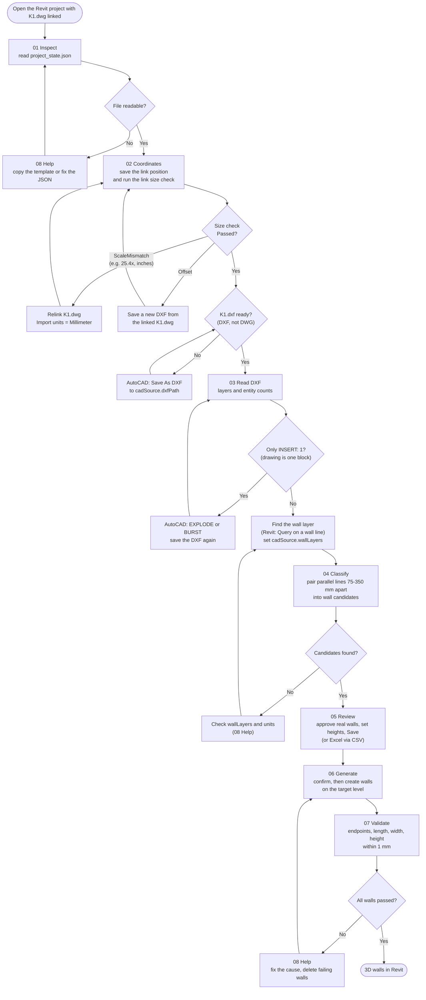
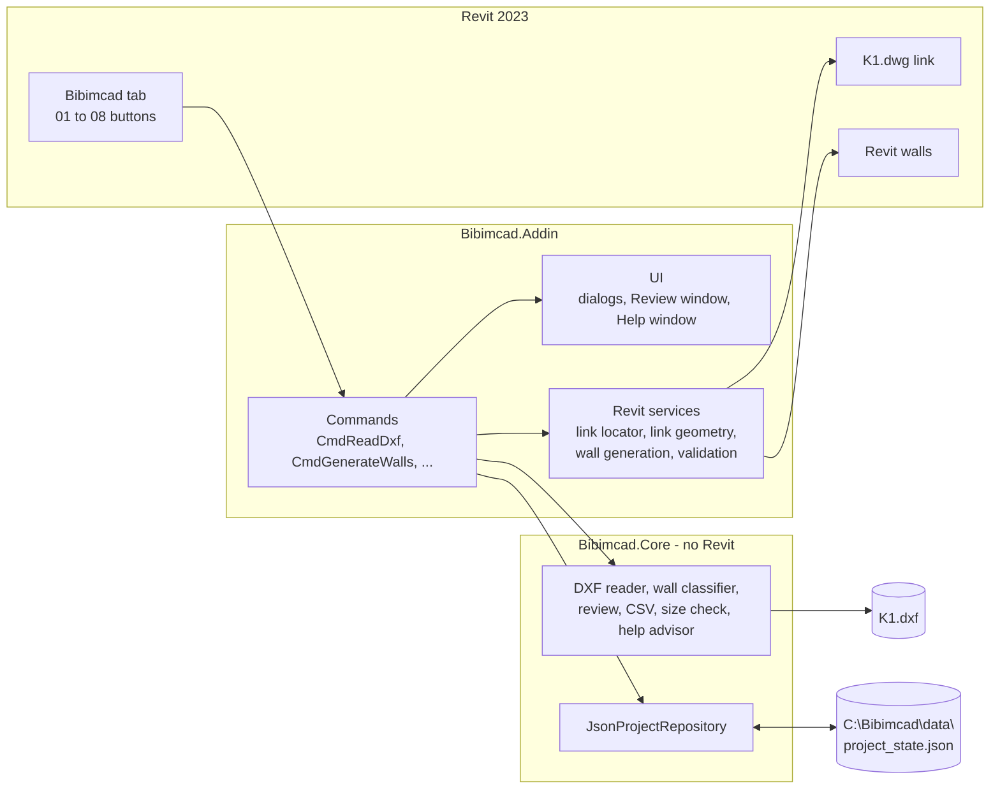
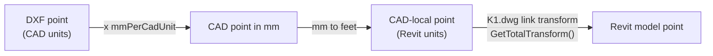

# How Bibimcad works

## The workflow in Revit

**08 Help** can be clicked at any point. It reads `project_state.json` and lists the problems it finds, with numbered steps.

Rerunning is safe:
- **04 Classify** keeps the review of walls whose geometry did not change.
- **06 Generate** never duplicates walls. It skips existing walls and recreates deleted ones.

## What each button reads and writes

Every button goes through the same layers and the same file.

| Button | Reads | Writes in `project_state.json` | Changes the Revit model |
| --- | --- | --- | --- |
| 01 Inspect | project_state.json | nothing | No |
| 02 Coordinates | K1.dwg link, K1.dxf | `revitLink` (position and `sizeCheck`) | No |
| 03 Read DXF | K1.dxf | `cadAudit`, `cadSource.headerInsUnits` | No |
| 04 Classify | K1.dxf, `wallLayers` | `wallClassification`, `wallCandidates` | No |
| 05 Review | `wallCandidates` | status, height, notes of candidates | No |
| 06 Generate | approved candidates, K1.dwg link | `revitElementId` of each wall | Yes: walls and wall types |
| 07 Validate | approved candidates, Revit walls | `validation` | No |
| 08 Help | project_state.json | nothing | No |

## How a CAD point becomes a Revit point

The link transform is read from the live K1.dwg link every time, so moving the link moves where new walls go. The link size check in **02 Coordinates** confirms that Revit draws the link at the same size as this path assumes.
